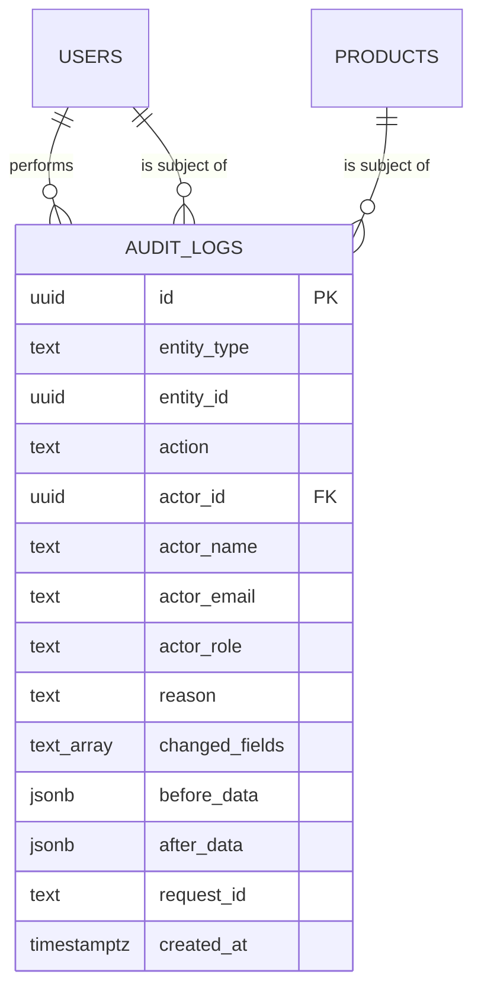
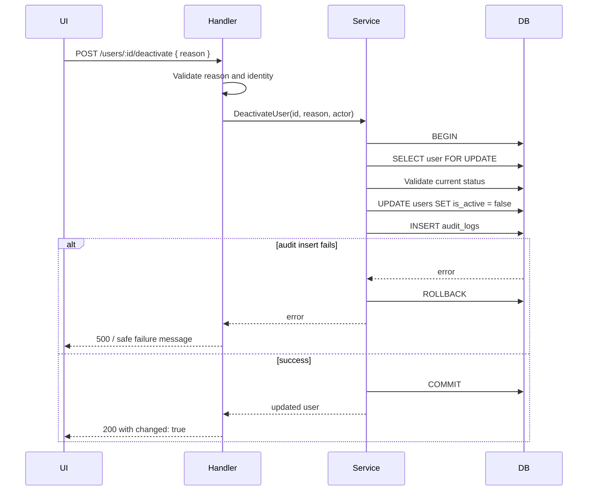

# Audit History and User Activation — Implementation Plan

- **Status:** Approved for implementation planning
- **Confirmed:** 2026-11-15
- **Implementation:** Not started
- **Scope:** User account activation/deactivation history, product cost history, and the audit read views required by Warehouse Admin and Supervisor.

---

## 1. Purpose

The WMS currently records inventory movements, but it does not keep an audit trail for account access or product cost changes. This plan defines an append-only audit history that answers:

- Who activated or deactivated a user?
- When did it happen, and why?
- Who changed a product cost, and what were the old and new values?
- Which user or product was affected?
- Which request produced the change?

The primary requirement is that **every user activation and deactivation is checkable and auditable**. Product cost changes are included because they are financially sensitive and currently have no history.

This document is the implementation contract. Application code must not be changed until this plan is reviewed.

---

## 2. Confirmed decisions

| ID | Decision |
|---|---|
| D1 | This plan lives under `docs/audit-history/` and is tracked in Git through a narrow `.gitignore` exception. |
| D2 | A reason is **required** for every user activation and deactivation. Reason length is 5–500 characters after trimming. |
| D3 | User activation history is visible to **Warehouse Admin** and **Supervisor**. |
| D4 | Audit records are append-only. No update or delete through the application. |
| D5 | The business mutation and its audit record are written in the same database transaction. |
| D6 | User status changes use dedicated activate/deactivate endpoints. `PATCH /users/:id` must not change `is_active`. |
| D7 | Historical data is not backfilled. History starts at the migration timestamp. |
| D8 | Product cost values are visible in history only to Supervisor. Warehouse Admin sees that cost changed but not the values. |
| D9 | Demo seeding must not reactivate existing users or products. |
| D10 | Audit records are retained indefinitely for now. Retention/partitioning is a later operational decision. |
| D11 | Current application-level user management covers Department Users. If Admin/Supervisor account management is added later, the same audit rules apply. |
| D12 | Reason is required for status changes; it is optional for ordinary profile updates and product cost updates. |

---

## 3. Current state and evidence

| Area | Current behavior | Gap |
|---|---|---|
| Audit storage | Only `stock_movements` is append-only. | No general audit table or event history. |
| User update | [`user/service.go`](../../backend/internal/user/service.go) updates `is_active` as an ordinary field. | No actor, reason, before/after values, or dedicated event. |
| User UI | [`UserFormPage.tsx`](../../frontend/src/features/users/UserFormPage.tsx) uses an activation checkbox and sends `is_active` through `PATCH`. | A status change can happen without an explicit reason or confirmation. |
| User list | [`UserListPage.tsx`](../../frontend/src/features/users/UserListPage.tsx) shows only `updated_at`. | Users cannot inspect access history. |
| Product cost | [`product/service.go`](../../backend/internal/product/service.go) updates `unit_cost`. | No record of who changed the cost or the old/new values. |
| Product UI | [`ProductDetailPage.tsx`](../../frontend/src/features/products/ProductDetailPage.tsx) shows stock movements only. | Cost history is invisible. |
| Seed data | [`seed.go`](../../backend/internal/database/seed.go) updates existing users/products with `is_active = true`. | A demo reset can silently reactivate accounts and products. |
| API access | Routes are registered in [`main.go`](../../backend/cmd/api/main.go). | No history endpoints or read authorization for Supervisor. |

The existing inventory migration [`0005_inventory.up.sql`](../../backend/migrations/0005_inventory.up.sql) already demonstrates the append-only and immutability-trigger pattern that should be reused.

---

## 4. Goals and non-goals

### Goals

1. Record every user creation, activation, deactivation, profile change, and password change.
2. Record every product cost change, product status change, and ordinary product update.
3. Require a reason for user activation and deactivation.
4. Store immutable actor snapshots and sanitized before/after values.
5. Expose paginated history to Warehouse Admin and Supervisor.
6. Prevent unaudited user status changes through the existing `PATCH` endpoint.
7. Prevent seed data from bypassing audit rules.
8. Keep the implementation testable and safe under failure.

### Non-goals

- Reconstructing history that predates the migration.
- Auditing inventory movements again; `stock_movements` remains the source of truth for stock.
- Auditing read-only actions.
- Adding a full compliance/export subsystem.
- Adding account deletion. The application uses deactivation.
- Changing approval, receiving, request, or return workflows.

---

## 5. Audit event model

### 5.1 Event catalog

| Action | Trigger | Reason | Before/after |
|---|---|---|---|
| `USER_CREATED` | A new user is created. Initial status is active. | Optional | `after` contains safe account fields. |
| `USER_ACTIVATED` | An inactive user is reactivated. | Required | `is_active: false → true`. |
| `USER_DEACTIVATED` | An active user is deactivated. | Required | `is_active: true → false`. |
| `USER_PROFILE_UPDATED` | Name, email, role, or department changes. | Optional | Changed safe fields only. |
| `USER_PASSWORD_CHANGED` | A password is replaced. | Optional | `password_changed: true`; never the hash. |
| `PRODUCT_COST_UPDATED` | `unit_cost` changes. | Optional | Old and new cost. |
| `PRODUCT_ACTIVATED` | An inactive product is reactivated. | Optional | `is_active: false → true`. |
| `PRODUCT_DEACTIVATED` | An active product is deactivated. | Optional | `is_active: true → false`. |
| `PRODUCT_UPDATED` | Non-cost product fields change. | Optional | Changed safe fields only. |

`USER_CREATED` counts as the initial activation event. Do not also insert a duplicate `USER_ACTIVATED` row for creation.

### 5.2 Event rules

- One API request may produce more than one audit row only when genuinely different event types occur. Example: a profile update that also changes a password produces `USER_PROFILE_UPDATED` and `USER_PASSWORD_CHANGED`.
- If the requested status already equals the current status, return success with `changed: false` and write no audit row. Do not create duplicate no-op events.
- Audit writes must never be best-effort. If the audit insert fails, the business change must fail.
- Never audit secrets, password hashes, tokens, or request bodies.
- Store full safe snapshots for context and a `changed_fields` array for precise rendering.
- Do not create synthetic records for pre-migration history.

---

## 6. Data model

### 6.1 Migration

Create a new migration pair under `backend/migrations/` after the current highest migration.

```sql
CREATE TABLE audit_logs (
    id UUID PRIMARY KEY DEFAULT gen_random_uuid(),
    entity_type TEXT NOT NULL CHECK (entity_type IN ('USER', 'PRODUCT', 'CATEGORY', 'UNIT')),
    entity_id UUID NOT NULL,
    action TEXT NOT NULL CHECK (action IN (
        'USER_CREATED',
        'USER_ACTIVATED',
        'USER_DEACTIVATED',
        'USER_PROFILE_UPDATED',
        'USER_PASSWORD_CHANGED',
        'PRODUCT_COST_UPDATED',
        'PRODUCT_ACTIVATED',
        'PRODUCT_DEACTIVATED',
        'PRODUCT_UPDATED'
    )),
    actor_id UUID NOT NULL REFERENCES users(id) ON DELETE RESTRICT,
    actor_name TEXT NOT NULL,
    actor_email TEXT NOT NULL,
    actor_role TEXT NOT NULL,
    reason TEXT,
    changed_fields TEXT[] NOT NULL DEFAULT '{}',
    before_data JSONB,
    after_data JSONB,
    request_id TEXT,
    created_at TIMESTAMPTZ NOT NULL DEFAULT now(),
    CONSTRAINT audit_reason_length CHECK (
        reason IS NULL OR char_length(btrim(reason)) BETWEEN 5 AND 500
    ),
    CONSTRAINT audit_status_reason_required CHECK (
        action NOT IN ('USER_ACTIVATED', 'USER_DEACTIVATED')
        OR (
            reason IS NOT NULL
            AND char_length(btrim(reason)) BETWEEN 5 AND 500
        )
    )
);

CREATE INDEX idx_audit_logs_created_at
    ON audit_logs (created_at DESC);

CREATE INDEX idx_audit_logs_entity
    ON audit_logs (entity_type, entity_id, created_at DESC);

CREATE INDEX idx_audit_logs_actor
    ON audit_logs (actor_id, created_at DESC);

CREATE INDEX idx_audit_logs_action_created
    ON audit_logs (action, created_at DESC);

CREATE INDEX idx_audit_logs_request
    ON audit_logs (request_id)
    WHERE request_id IS NOT NULL;
```

The migration must also add the following immutability guard, following the `stock_movements` pattern:

```sql
CREATE FUNCTION reject_audit_log_mutation()
RETURNS trigger AS $$
BEGIN
    RAISE EXCEPTION 'audit_logs is append-only';
END;
$$ LANGUAGE plpgsql;

CREATE TRIGGER audit_logs_immutable
BEFORE UPDATE OR DELETE ON audit_logs
FOR EACH ROW EXECUTE FUNCTION reject_audit_log_mutation();
```

The down migration drops the trigger, function, indexes, and table.

### 6.2 Why actor snapshots are stored

`actor_id` links to the actor, while `actor_name`, `actor_email`, and `actor_role` preserve what the actor looked like at the time of the event. A later name, email, or role change must not rewrite history.

### 6.3 Entity relationship



`entity_id` is intentionally polymorphic and therefore has no foreign key. The target entity is never deleted by the application, so the identifier remains resolvable. If deletion is introduced later, audit history must remain readable without the deleted row.

### 6.4 Data handling

- `before_data` and `after_data` must contain only allow-listed, sanitized fields.
- User snapshots may include `full_name`, `email`, `role`, `department_id`, and `is_active`.
- User snapshots must never include `password_hash`, password reset tokens, or session data.
- Cost snapshots include `unit_cost`; redaction happens at the API boundary.
- Reasons are trimmed before validation and storage.

---

## 7. Transactional write design

The audit record and the mutation must commit or roll back together.



Implementation rules:

1. Read the actor identity from authenticated middleware context, never from the request body.
2. Begin a transaction in the service layer, where the full business operation is known.
3. Select the target row with `FOR UPDATE` to prevent concurrent status races.
4. Validate state and permissions inside the transaction.
5. Apply the business update.
6. Insert the audit record using the same transaction handle.
7. Commit only after both succeed.
8. Return `500` on audit failure; do not hide the failure or report success.

Suggested backend structure:

```text
backend/internal/audit/
  model.go        AuditLog, ActorSnapshot, Entry
  repository.go   Insert(tx, Entry) and read queries
  service.go      Event construction and redaction
  handler.go      GET /audit-logs
  dto.go          API response models
```

The exact package layout may follow existing backend conventions. The important constraint is a single auditable write path, not duplicate event logic in handlers.

---

## 8. API design

All endpoints use the existing authenticated API prefix and response envelope.

### 8.1 User status endpoints

| Method | Path | Roles | Purpose |
|---|---|---|---|
| `POST` | `/api/v1/users/:id/activate` | Warehouse Admin | Reactivate a user. |
| `POST` | `/api/v1/users/:id/deactivate` | Warehouse Admin | Deactivate a user. |
| `GET` | `/api/v1/users/:id/history` | Warehouse Admin, Supervisor | Paginated user history. |

Request body for both status endpoints:

```json
{
  "reason": "Transferred to another department; WMS access no longer required."
}
```

Validation:

- Required.
- Trimmed.
- 5–500 characters.
- Reject whitespace-only values with `422 VALIDATION`.
- Return `404 NOT_FOUND` when the user does not exist.
- Return `422 INVALID_STATE` when the requested state already applies, or return `200` with `changed: false` and no audit row. The implementation must choose one consistently. This plan recommends `200` with `changed: false` for idempotent UI retries.
- Deactivation must not be possible for the actor's own account if role management expands beyond Department Users. Add this guard before allowing Admin/Supervisor accounts to be managed.

Response:

```json
{
  "data": {
    "id": "00000000-0000-0000-0000-000000000000",
    "full_name": "Example User",
    "is_active": false
  },
  "meta": {
    "changed": true
  }
}
```

### 8.2 Profile update rule

`PATCH /api/v1/users/:id` remains the profile update endpoint, but:

- `is_active` is removed from its accepted schema.
- If a client still sends `is_active`, reject the request with `422 VALIDATION` and a clear message directing the client to the activate/deactivate endpoint.
- The frontend must stop sending `is_active` from the edit form.
- This prevents an unaudited bypass.

### 8.3 Product history endpoint

| Method | Path | Roles | Purpose |
|---|---|---|---|
| `GET` | `/api/v1/products/:id/history` | Warehouse Admin, Supervisor | Paginated product history. |

Product activation can continue through the existing product update path in Phase 2, but the service must classify status and cost changes into the correct audit events. If the product update path is later moved to dedicated endpoints, the audit rules remain the same.

### 8.4 Global audit endpoint

| Method | Path | Roles | Purpose |
|---|---|---|---|
| `GET` | `/api/v1/audit-logs` | Warehouse Admin, Supervisor | Search and browse audit history. |

Supported query parameters:

| Parameter | Notes |
|---|---|
| `entity_type` | `USER` or `PRODUCT` |
| `entity_id` | UUID |
| `action` | One action or comma-separated actions |
| `actor_id` | UUID |
| `from` / `to` | ISO-8601 timestamps |
| `page` / `page_size` | Default 1 / 20; maximum 100 |
| `sort` | Default `created_at:desc` |

Results are ordered by `created_at DESC, id DESC` for stable pagination.

### 8.5 History response shape

```json
{
  "data": [
    {
      "id": "00000000-0000-0000-0000-000000000000",
      "entity_type": "USER",
      "entity_id": "00000000-0000-0000-0000-000000000000",
      "action": "USER_DEACTIVATED",
      "actor": {
        "id": "00000000-0000-0000-0000-000000000000",
        "full_name": "Warehouse Admin",
        "email": "admin@example.com",
        "role": "WAREHOUSE_ADMIN"
      },
      "reason": "Transferred to another department; WMS access no longer required.",
      "changed_fields": ["is_active"],
      "before": { "is_active": true },
      "after": { "is_active": false },
      "redacted_fields": [],
      "request_id": "request-id",
      "created_at": "2026-11-15T10:00:00Z"
    }
  ],
  "meta": {
    "page": 1,
    "page_size": 20,
    "total": 1
  }
}
```

### 8.6 Cost redaction

| Viewer | Product cost event | `before` / `after` cost values |
|---|---|---|
| Supervisor | Visible | Visible |
| Warehouse Admin | Visible as an event | Omitted and listed in `redacted_fields` |
| Department User | No access | No access |

For a redacted response:

```json
{
  "changed_fields": ["unit_cost"],
  "before": {},
  "after": {},
  "redacted_fields": ["unit_cost"]
}
```

The UI must render “Unit cost changed (value hidden)” rather than an empty or zero value. Redaction must happen in the backend response layer. Do not rely on hiding fields in the browser.

---

## 9. UI design

### 9.1 User edit page

Replace the active-status checkbox with an explicit status section:

- Current status badge.
- `Deactivate account` button when active.
- `Reactivate account` button when inactive.
- A confirmation dialog with a required reason field.
- Character count and validation for 5–500 characters.
- Warning that deactivation blocks the next login/request.
- On success, refresh the user, user list, and history queries.
- Show a read-only `Account history` card on the same page for Admin.

The create-user form continues to create an active account. It must not expose a status toggle.

### 9.2 Audit history page

Add a page at `/audit`, visible in the main navigation to Warehouse Admin and Supervisor:

- Default filter: `entity_type=USER`.
- Tabs or filter control for `Users` and `Products`.
- Filters for action, actor, and date range.
- Table columns: when, event, subject, change summary, by, reason.
- Row expansion or detail drawer showing before/after values and request ID.
- Pagination.
- Empty, loading, and error states consistent with the rest of the application.

Add `History` to the icon map in `AppShell.tsx` and a nav entry in `lib/constants.ts` for the two roles. Do not make user management editable for Supervisor; only the read-only history view is shared.

### 9.3 User history view

The user history view should render readable event labels, not raw JSON:

- “Account created (active)”
- “Account deactivated”
- “Account reactivated”
- “Profile updated”
- “Password changed”

For ordinary profile updates, list changed field names. For status events, show `Active → Inactive` or `Inactive → Active`. Always show actor, timestamp, and reason.

### 9.4 Product detail page

Add a `Change history` card under the existing stock movement section:

- Show product cost, status, and profile events.
- Show cost values only to Supervisor.
- Warehouse Admin sees the event with `Unit cost changed (value hidden)`.
- Use the same audit table/detail components as the global audit page.

### 9.5 Internationalization

Add EN/ID/ZH keys in [`dictionary.ts`](../../frontend/src/i18n/dictionary.ts) for:

- Navigation label.
- Page title and description.
- Event actions.
- Field labels.
- Reason dialog title, label, placeholder, validation errors.
- Empty/loading/error states.
- Redaction notice.
- Status transition labels.

Do not build event labels by concatenating translated words in an order that may not work in all three languages. Use full label templates.

---

## 10. Backend implementation checklist

### 10.1 Audit package

- [ ] Add `AuditLog` model with JSON tags for API use.
- [ ] Add `ActorSnapshot` construction from authenticated identity.
- [ ] Add `Entry` builder that trims reason and rejects invalid lengths.
- [ ] Add `Insert(tx, entry)` that uses the caller's transaction.
- [ ] Add read repository with filtering and pagination.
- [ ] Add response redaction for product cost values.
- [ ] Add tests for event classification, reason validation, and redaction.

### 10.2 User service

- [ ] Add `ActivateUser` and `DeactivateUser` service methods.
- [ ] Begin a transaction and lock the target user row.
- [ ] Compare current and requested status.
- [ ] Update `users.is_active`.
- [ ] Write the audit row before commit.
- [ ] Remove `is_active` from profile update handling.
- [ ] Write `USER_CREATED` on creation.
- [ ] Write `USER_PROFILE_UPDATED` for safe field changes.
- [ ] Write `USER_PASSWORD_CHANGED` separately from profile changes.
- [ ] Ensure password hashes never enter audit data.

### 10.3 Product service

- [ ] Capture the current product before applying updates.
- [ ] Write `PRODUCT_COST_UPDATED` when `unit_cost` changes.
- [ ] Write `PRODUCT_ACTIVATED` or `PRODUCT_DEACTIVATED` on status changes.
- [ ] Write `PRODUCT_UPDATED` for other field changes.
- [ ] Avoid duplicate events when only one field changes.
- [ ] Include the actor identity in product service calls.

### 10.4 API and routing

- [ ] Add user activate/deactivate routes.
- [ ] Add user history and product history routes.
- [ ] Add global audit route.
- [ ] Restrict status mutations to Warehouse Admin.
- [ ] Allow history reads to Warehouse Admin and Supervisor.
- [ ] Return `403` for Department Users and unauthenticated requests.
- [ ] Add request ID to audit entries when available.

### 10.5 Seed and reset

- [ ] Remove `is_active = true` from the seed conflict/update clause for users.
- [ ] Remove `is_active = true` from the seed conflict/update clause for products.
- [ ] Keep initial inserts active.
- [ ] Add `audit_logs` to the demo reset truncation list.
- [ ] Add a regression test proving a repeated seed does not reactivate existing records.
- [ ] Ensure production does not run demo seeding.

### 10.6 Migration and deployment order

1. Apply the additive `audit_logs` migration.
2. Deploy backend with audit writes and new read endpoints.
3. Deploy frontend that uses the new status endpoints and no longer sends `is_active` in `PATCH`.
4. Verify that old clients cannot bypass status auditing.

This is a coordinated release because removing `is_active` from `PATCH` is intentionally breaking. The migration itself is additive and safe to apply before the application release.

---

## 11. Frontend implementation checklist

- [ ] Add audit/history types to [`types/index.ts`](../../frontend/src/types/index.ts).
- [ ] Add API clients to [`endpoints.ts`](../../frontend/src/api/endpoints.ts).
- [ ] Add a reusable `AuditHistoryTable` and detail component.
- [ ] Add a `StatusChangeDialog` with required reason validation.
- [ ] Update user create/edit forms to remove the status checkbox.
- [ ] Add explicit activate/deactivate actions to the user edit view.
- [ ] Add the account history card to the user edit view for Admin.
- [ ] Add the global audit page and route.
- [ ] Add navigation entries for Admin and Supervisor.
- [ ] Add product change history to the product detail page.
- [ ] Implement cost redaction rendering for Admin.
- [ ] Add EN/ID/ZH translations.
- [ ] Check mobile layout, especially table overflow and dialog controls.

---

## 12. Test plan

### Backend unit tests

- [ ] Reason is required for activate/deactivate.
- [ ] Reason shorter than 5 characters or longer than 500 is rejected.
- [ ] Whitespace-only reason is rejected.
- [ ] Status transition event classification is correct.
- [ ] No-op status requests do not create audit rows.
- [ ] Password changes never include a hash.
- [ ] Cost changes produce `PRODUCT_COST_UPDATED`.
- [ ] Non-cost product changes produce `PRODUCT_UPDATED`.
- [ ] Redaction removes cost values for Warehouse Admin.

### Backend integration tests

- [ ] User creation writes one `USER_CREATED` row.
- [ ] User activation writes one `USER_ACTIVATED` row with reason.
- [ ] User deactivation writes one `USER_DEACTIVATED` row with reason.
- [ ] Update and audit insert roll back together when audit insertion fails.
- [ ] `PATCH /users/:id` rejects `is_active`.
- [ ] Supervisor can read history.
- [ ] Warehouse Admin can read history and manage status.
- [ ] Department User receives `403` for history endpoints.
- [ ] Product cost update writes the old and new values.
- [ ] Repeated seed does not reactivate a deactivated user or product.
- [ ] Audit table rejects update and delete attempts.
- [ ] Pagination is stable when multiple rows share a timestamp.

### Frontend tests

- [ ] Deactivation dialog blocks an empty or short reason.
- [ ] Successful deactivation refreshes the user and history.
- [ ] History renders user activation and deactivation events.
- [ ] Empty history has a clear empty state.
- [ ] Warehouse Admin sees redacted cost text, not zero or blank.
- [ ] Supervisor sees cost values.
- [ ] Supervisor can open the audit page but cannot manage users.
- [ ] EN/ID/ZH labels render without missing keys.

### End-to-end flows

1. Admin creates a Department User, deactivates with a reason, and verifies the user cannot use WMS.
2. Admin reactivates with a reason and verifies access returns.
3. Supervisor opens audit history and sees both events, including actor and reason.
4. Supervisor changes a product cost; Supervisor sees old and new values in history.
5. Admin opens the same product history and sees that cost changed without seeing the values.
6. Demo seed is run twice; a manually deactivated user stays inactive.

---

## 13. Acceptance criteria

The implementation is complete when:

- [ ] Every user creation, activation, and deactivation produces an immutable audit record.
- [ ] Activation and deactivation require a valid reason.
- [ ] The actor, timestamp, reason, and status transition are visible to Admin and Supervisor.
- [ ] User status cannot be changed through `PATCH /users/:id`.
- [ ] Existing seed data cannot reactivate users or products.
- [ ] Product cost changes record actor, timestamp, old value, and new value.
- [ ] Cost values are hidden from Warehouse Admin in history responses and UI.
- [ ] Audit write failure rolls back the business change.
- [ ] History pages are paginated, filterable, and usable on mobile.
- [ ] EN/ID/ZH translations are complete.
- [ ] Backend, frontend, and seed regression tests pass.
- [ ] Business-guide documentation is updated after implementation.

---

## 14. Rollout and rollback

### Rollout

1. Back up the database according to the existing operational process.
2. Apply the additive migration.
3. Deploy backend.
4. Deploy frontend.
5. Run smoke tests for user deactivate/reactivate and product cost update.
6. Confirm that Admin and Supervisor can read history.
7. Confirm that Department Users cannot read audit data.

### Rollback

- Roll back frontend first if the new status endpoints are unavailable.
- Roll back backend only if the audit table migration remains harmless.
- Do not drop the audit table during an incident unless data loss is explicitly approved. It contains the only record of newly audited actions.
- The down migration exists for development resets, not routine production rollback.

---

## 15. Implementation sequence

### Phase 0 — Review

- Review and approve this document.
- Confirm that no application changes are made before approval.

### Phase 1 — Audit foundation

- Add migration and immutability trigger.
- Add audit model, repository, service, and redaction helpers.
- Add transaction plumbing.
- Add backend tests for the audit package.

### Phase 2 — User activation vertical slice

- Add activate/deactivate endpoints with required reason.
- Remove `is_active` from profile updates.
- Add `USER_CREATED`, `USER_PROFILE_UPDATED`, and `USER_PASSWORD_CHANGED` events.
- Fix seed reactivation.
- Add user history API.
- Add status dialog, status actions, and account history UI.
- Add global audit page and navigation for Admin/Supervisor.
- Add translations and end-to-end tests.

### Phase 3 — Product cost and status history

- Add product history API.
- Add cost/status/profile event classification.
- Add product change history UI.
- Enforce cost redaction for Admin.
- Add tests for cost visibility and product status changes.

### Phase 4 — Documentation and release

- Update the business guide:
  - `00-documentation-index.md`
  - `02-business-process-flow.md`
  - `03-user-manual.md`
  - `04-roles-and-responsibilities.md`
  - `05-standard-operating-procedures.md`
  - `06-admin-management-guide.md`
  - `07-status-and-approval-guide.md`
  - `09-troubleshooting-faq.md`
  - `10-quick-reference.md`
  - `ANALYSIS-REPORT.md`
- Add an audit-history guide and screenshots.
- Refresh any screenshots affected by the mobile layout change.
- Run full validation and smoke tests.

---

## 16. Risks and mitigations

| Risk | Impact | Mitigation |
|---|---|---|
| Audit insert succeeds but business update rolls back | False history | Use one transaction and commit only after both succeed. |
| Business update succeeds but audit insert fails | Unauditable change | Treat audit failure as a request failure and roll back. |
| Passwords or hashes leak into history | Security incident | Allow-list fields and test serialized audit payloads. |
| Cost values leak to Admin | Confidentiality breach | Redact in the backend response, not only in the UI. |
| Seed reactivates accounts | Audit bypass | Remove status from conflict updates and add a regression test. |
| Duplicate events on retries | Misleading history | Idempotent no-op responses with no audit row. |
| Old frontend bypasses reason requirement | Incomplete audit | Remove `is_active` from profile update and coordinate release. |
| History table grows unbounded | Query/storage pressure | Indexes now; define retention/partitioning later. |
| Pre-migration changes appear untracked | User confusion | Label history as starting from the deployment date. |

---

## 17. Remaining operational decisions

These do not block implementation:

- Final retention period and archival policy for `audit_logs`.
- Whether a future export endpoint is required.
- Whether request IP/user-agent fields should be added for compliance.
- Whether audit logs should be partitioned by month after volume is measured.

If any of these become required, add them as a separate plan rather than expanding this implementation silently.

---

## 18. Definition of done

A reviewer must be able to demonstrate all of the following from the running application:

1. An Admin deactivates a user with a reason.
2. A Supervisor sees the actor, time, reason, and `Active → Inactive` change.
3. The user cannot log in or submit requests while inactive.
4. An Admin reactivates the user with a reason.
5. The Supervisor sees the reactivation event.
6. A Supervisor changes a product cost.
7. The Supervisor sees the old and new cost.
8. An Admin sees the cost event but not the values.
9. Running the demo seed again does not reactivate the user.
10. The audit table rejects direct update and delete attempts.

Only then is the audit history feature considered complete.
